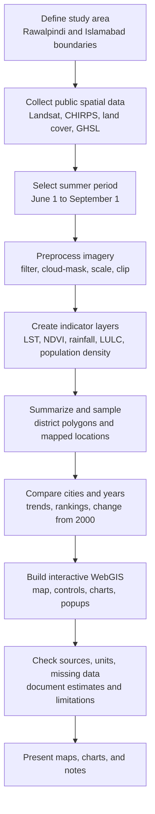

# UrbanSense: Twin Cities WebGIS

**A personal WebGIS progress project by Laiba Rafi** exploring climate, vegetation, land cover, rainfall, and population patterns in Rawalpindi and Islamabad.

## Table of contents

1. [Project overview](#project-overview)
2. [Purpose and questions](#purpose-and-questions)
3. [Methodology workflow](#methodology-workflow)
4. [Detailed methodology](#detailed-methodology)
   - [Study area and boundaries](#1-study-area-and-boundaries)
   - [Data collection](#2-data-collection)
   - [Preprocessing](#3-preprocessing)
   - [Indicator generation](#4-indicator-generation)
   - [Spatial sampling and summaries](#5-spatial-sampling-and-summaries)
   - [Temporal and city comparison](#6-temporal-and-city-comparison)
   - [Interactive WebGIS implementation](#7-interactive-webgis-implementation)
   - [Validation and interpretation](#8-validation-and-interpretation)
5. [Data sources and resolutions](#data-sources-and-resolutions)
6. [What a user can explore](#what-a-user-can-explore)
7. [Outputs](#outputs)
8. [Limitations and responsible use](#limitations-and-responsible-use)
9. [Future recommendations](#future-recommendations)
10. [Technology](#technology)
11. [Author](#author)

## Project overview

UrbanSense is an interactive map and analysis dashboard for learning how remote-sensing data and web mapping can be combined to explore two neighboring urban areas. Users can move through the available years, turn map layers on and off, inspect mapped locations, view charts, and compare selected indicators between Rawalpindi and Islamabad.

The current analysis period is presented as **2000–2026**. The exact data coverage differs by indicator: satellite observations can be missing in some years, 2026 is a partial June–August period, and population is available as five-year epochs rather than annual observations.

## Purpose and questions

The platform is intended to help a learner or general audience explore questions such as:

- Where are sampled summer land-surface temperatures highest or lowest in a selected year?
- How does summer rainfall vary across the mapped locations?
- Which sampled locations show the strongest increase or decrease in NDVI since 2000?
- How does gridded population density change between available population epochs?
- How do mapped and district-level indicators compare between Rawalpindi and Islamabad?
- What can an interactive WebGIS show, and where should its estimates be treated cautiously?

These are exploratory questions. The dashboard is not a substitute for official census tables, ground measurements, or a validated urban-climate model.

## Methodology workflow

### Workflow at a glance

| Stage | What happens | Main output |
|---|---|---|
| 1. Study-area definition | Administrative outlines define the two areas of interest. | Clipped analysis extent and city polygons |
| 2. Data collection | Public Earth Engine image collections and project boundary files are accessed. | Source imagery and vector boundaries |
| 3. Preprocessing | Data are filtered to the season, masked or scaled where required, harmonized, and clipped. | Comparable seasonal images and analysis-ready bands |
| 4. Indicator generation | Temperature, greenness, rainfall, land-cover class, and population density layers are prepared. | Thematic raster layers |
| 5. Spatial analysis | Raster values are summarized over administrative polygons and sampled at the available mapped coordinates. | District summaries and location-level values |
| 6. Comparison | Cities and years are compared; change modes compare a selected year with 2000 where data are available. | Trend charts and ranked locations |
| 7. WebGIS presentation | The frontend displays map layers, controls, charts, and value details from the API. | Interactive browser-based dashboard |
| 8. Interpretation | Sources, resolutions, incomplete years, and modeled profile data are identified. | Context for reading the results responsibly |

## Detailed methodology

### 1. Study area and boundaries

The study area consists of the Islamabad Capital Territory and Rawalpindi District. Administrative polygons included with the project provide the geographic frame for Earth Engine clipping and district-level summaries. Neighborhood or representative points are used for map inspection and ranked-point displays.

A mapped point represents the raster value at its coordinate; it is not an average of an entire neighborhood unless specifically computed as a polygon statistic.

### 2. Data collection

The backend requests public raster datasets from Google Earth Engine. This avoids downloading and storing every source image in the repository, but it requires an authenticated Earth Engine account and an enabled Cloud project when running the live analysis endpoints.

- **Landsat Collection 2 Level 2:** Landsat 5, 7, 8, and 9 observations provide optical reflectance and thermal data, depending on year and valid scene availability.
- **CHIRPS Daily:** Daily precipitation estimates are used to derive a June–August rainfall total.
- **Dynamic World:** 10 m land-cover classifications are used for 2015 onward.
- **MODIS MCD12Q1:** Annual 500 m land-cover classes are used for earlier years, with a simplified class crosswalk. MODIS has no 2000 annual image in this implementation, so its earliest proxy is 2001.
- **GHSL P2023A:** Population-count rasters provide five-year population epochs. The selected map year is matched to a five-year epoch; 2025 is a projection in this product.
- **Administrative boundaries:** Bundled GeoJSON/JSON boundary data define the study areas. CARTO Voyager supplies the map background.

### 3. Preprocessing

1. **Filter by location and time.** Earth Engine collections are filtered to the Rawalpindi–Islamabad area and to June 1 through September 1. The end date is exclusive, so this covers June, July, and August.
2. **Mask clouds and shadows.** Landsat `QA_PIXEL` flags are used to remove cloud, cloud-shadow, snow, and fill pixels; a cirrus flag is also applied for Landsat 8 and 9.
3. **Convert Landsat values.** Surface reflectance scale and offset are applied before NDVI is calculated. Thermal-band scale and offset are applied and converted from Kelvin to Celsius for LST.
4. **Combine valid Landsat observations.** Clear summer observations from available Landsat missions are merged, then a median composite is created for the selected year.
5. **Summarize rainfall.** Daily CHIRPS precipitation values within the summer window are summed to millimeters.
6. **Prepare land cover.** Dynamic World uses the summer modal class; pre-2015 MODIS IGBP classes are mapped to broader project labels. The sources have different spatial resolutions and class definitions.
7. **Prepare population density.** GHSL population counts are converted to people per square kilometer for the map layer; its five-year epoch is retained as metadata.
8. **Clip and preserve missing data.** Images are clipped to the study area. A missing valid observation remains missing rather than being interpreted as zero.

### 4. Indicator generation

**Normalized Difference Vegetation Index (NDVI)** estimates relative vegetation greenness from red and near-infrared surface reflectance:

\[
NDVI = \frac{NIR - Red}{NIR + Red}
\]

NDVI ranges approximately from −1 to +1. Higher positive values often indicate greener vegetation, but NDVI is not a direct measurement of tree canopy percentage or vegetation health on its own.

**Land-surface temperature (LST)** is derived from Landsat surface-temperature bands, converted to Celsius, and composited across valid summer observations. LST is the temperature of the observed land surface; it is not the same as air temperature experienced at a weather station.

**Summer precipitation** is the sum of CHIRPS daily precipitation for June–August, in millimeters. CHIRPS is much coarser than Landsat, so neighboring point samples may share the same precipitation pixel.

**Land use/land cover (LULC)** is a categorical class, not a continuous index. Dynamic World and MODIS values should not be treated as perfectly interchangeable because the sensors, classification systems, and pixel sizes differ.

**Population density** is derived from the GHSL population-count grid divided by pixel area. The product is available at five-year epochs; year selection does not create a new annual census estimate.

### 5. Spatial sampling and summaries

The platform has two different spatial analysis paths:

- **Point samples:** The point-indicators API samples current Earth Engine raster values at coordinates provided by the mapped locations. Available indicators include LST, NDVI, CHIRPS rainfall, LULC, and GHSL population density. The underlying pixel resolution varies substantially: about 30 m for Landsat, about 5.6 km for CHIRPS, 10 m for Dynamic World, 500 m for MODIS, and about 100 m for GHSL.
- **Administrative-area summaries:** Climate, vegetation, rainfall, and population series are reduced over the two administrative polygons. These provide district-level comparisons and are not neighborhood-level measurements.

The **Extreme locations** control ranks up to five of the currently mapped/sampleable locations. “Increase” selects positive differences and “decrease” selects negative differences between the chosen year and 2000. Highest/lowest options rank the sampled values for the selected year. Because the map uses a limited set of points, these ranks are not guaranteed to be the true citywide raster maxima or minima.

### 6. Temporal and city comparison

Annual summer LST, NDVI, and precipitation summaries are generated for each administrative area where valid data exist. The dashboard compares Rawalpindi and Islamabad using time-series charts and district-level summaries. The selected year can be changed from the interface.

Population is shown at the GHSL epochs (2000, 2005, and subsequent five-year steps through 2025), rather than as measured annual values. Change-ranked map points compare raster samples from a selected year with the 2000 sample. Differences use each indicator’s own unit: °C for LST, millimeters for rainfall, NDVI units for vegetation, and people per km² for population density.

### 7. Interactive WebGIS implementation

A React and TypeScript frontend presents the map, layer selector, year control, charts, legend, location popups, city comparisons, and scenario interface. A FastAPI backend exposes endpoints for boundaries, Earth Engine tile URLs, raster point samples, land-cover summaries, temporal analytics, and population comparisons. The frontend’s Vite development server proxies `/api` requests to the local backend.

Map tiles are requested for the chosen year and indicator. Point details and charts are served through API responses. Earth Engine authentication and network availability are necessary for live source-derived outputs.

### 8. Validation and interpretation

The current work focuses on data processing and interactive presentation. The project does not claim comprehensive ground validation. Before using results for planning or policy, future work should:

- Compare LST with suitable local station or reference data while accounting for the difference between surface and air temperature.
- Compare population estimates with Pakistan Bureau of Statistics census data and document boundary/year differences.
- Validate land-cover classes with independent higher-resolution reference imagery or field observations.
- Record sample counts, cloud-free observation coverage, and valid-pixel masks by year.
- Test how results change with alternative seasons, spatial units, and sample spacing.
- Keep modeled/interpolated values visibly separate from observed or raster-derived values.

## Data sources and resolutions

| Theme | Dataset / method | Approximate resolution and time handling | Notes |
|---|---|---|---|
| Surface temperature | Landsat Collection 2 Level 2 | 30 m; summer composites where valid scenes exist | Surface temperature in °C, not air temperature |
| Vegetation | Landsat NDVI from scaled surface reflectance | 30 m; summer composite | Greenness index, not canopy percent |
| Rainfall | CHIRPS Daily, summed June–August | About 5.6 km; seasonal total | Coarse relative to the urban neighborhoods |
| Land cover | Dynamic World | 10 m; summer mode, 2015 onward | Categorical classification |
| Historical land cover | MODIS MCD12Q1 | 500 m; annual product, proxy begins 2001 | Coarse classes are harmonized to broad project labels |
| Population | GHSL P2023A population grid | About 100 m; five-year epochs | 2025 epoch is projected; not an annual census series |
| Basemap | CARTO Voyager | Web map tiles | Requires internet; a CARTO key may be configured locally |
| Boundaries | Bundled administrative boundary files | Vector polygons | Boundary vintage and scale can affect area summaries |

Official dataset pages: [Landsat Collection 2 Level 2](https://developers.google.com/earth-engine/datasets/catalog/LANDSAT_LC08_C02_T1_L2), [CHIRPS Daily](https://developers.google.com/earth-engine/datasets/catalog/UCSB-CHG_CHIRPS_DAILY), [Dynamic World](https://developers.google.com/earth-engine/datasets/catalog/GOOGLE_DYNAMICWORLD_V1), [MODIS MCD12Q1](https://developers.google.com/earth-engine/datasets/catalog/MODIS_061_MCD12Q1), and [GHSL population](https://developers.google.com/earth-engine/datasets/catalog/JRC_GHSL_P2023A_GHS_POP).

## What a user can explore

1. Choose a year with the year control.
2. Select an Earth Engine analysis layer such as temperature, NDVI, rainfall, land cover, or population density.
3. Turn administrative boundaries and other overlays on or off.
4. Choose an **Extreme locations** mode to show ranked map points; leave it at “No points” for a clear map.
5. Click a mapped location to inspect the available indicator values and data-source notes.
6. Open the charts view to compare temporal patterns, population epochs, and district indicators.
7. Explore the predictive scenario interface as an assumption-based visualization, not as a validated forecast.

## Outputs

- Interactive twin-cities WebGIS map and thematic raster layers.
- Summer time-series charts for available climate and vegetation indicators.
- Five-year GHSL population comparison chart.
- District-level indicator comparison and land-cover summaries.
- Ranked locations for selected-year extremes or indicator changes since 2000.
- An experimental scenario interface for exploring possible impacts.

## Limitations and responsible use

- This is a personal GIS progress and learning project, not an official monitoring, planning, or emergency-response system.
- Some endpoint properties and added representative locations come from locally stored reference profiles and interpolation. Those are **modeled estimates**, not independently sampled Earth Engine values.
- Earth Engine point samples represent raster pixels at the supplied coordinates; they are not automatically averages for whole neighborhoods.
- Extreme-location ranking only considers the mapped sample locations. Continuous raster analysis or denser sampling is needed for comprehensive citywide hot/cold spots and change hotspots.
- Raster resolutions differ. A 30 m Landsat pixel and a roughly 5.6 km CHIRPS pixel describe very different spatial scales.
- 2026 is partial-year data. Available scenes and valid observations can change; an empty value means no valid sample was returned, not zero heat, rain, vegetation, or population.
- Population surfaces are modeled gridded estimates, not a replacement for official census counts. GHSL outputs use five-year epochs, and its 2025 epoch is projected.
- Land-cover classification can be uncertain, and the pre-2015 MODIS crosswalk is coarse.
- Scenario controls illustrate assumptions and should not be interpreted as probabilities or forecasts.
- Use dataset citations, units, observation period, spatial resolution, boundary version, and uncertainty notes when sharing maps or charts.

## Future recommendations

1. Replace sparse point ranking with pixel-based citywide extreme and change analysis or a documented denser sampling grid.
2. Validate satellite temperature, land cover, and population against suitable local reference datasets.
3. Show per-year observation coverage, valid-pixel counts, uncertainty, source, and resolution directly in the interface.
4. Distinguish observed, interpolated, modeled, and projected values consistently across all charts and popups.
5. Improve the population comparison with clearly cited official census anchors and explicit interpolation methods where annual display is desired.
6. Calibrate scenario models using historical observations and show uncertainty ranges before describing them as predictive.
7. Secure a hosted deployment with managed credentials, restricted CORS, request limits, and server-side caching.
8. Add accessibility checks, responsive layouts, downloadable data with metadata, and documented reproducible analysis settings.

## Technology

- React, TypeScript, Vite, Tailwind CSS
- Leaflet and React Leaflet
- Recharts
- Python, FastAPI, Uvicorn
- Google Earth Engine Python API

## Author

**Laiba Rafi**  
Personal GIS progress work

### Setup and live platform

This public overview documents the project methodology and interpretation. The source code remains in a separate private repository. Running the full application requires a local setup, an authenticated Google Earth Engine account, an enabled Cloud project, and any required local basemap configuration. See the [Google Earth Engine authentication guide](https://developers.google.com/earth-engine/guides/auth).
